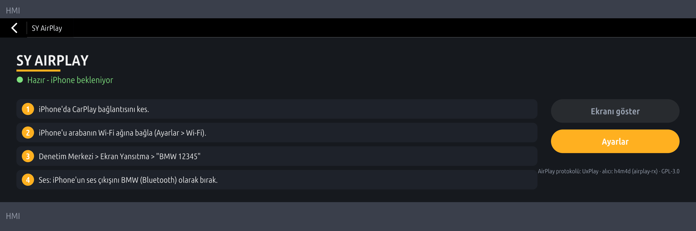
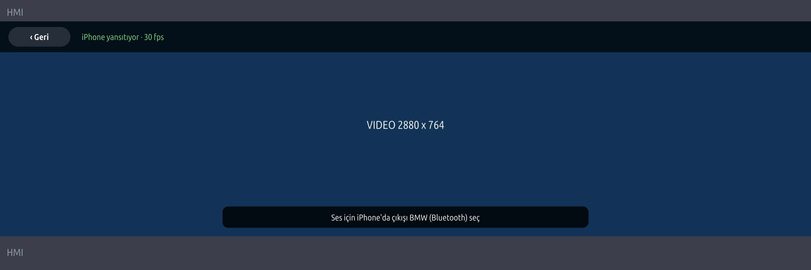

# SY AirPlay for iDrive 8 (deneysel: sürüşte görüntü)

**iPhone ekranını BMW iDrive 8 ekranına AirPlay ekran yansıtma ile getirir — [SY Car Data](https://github.com/smhcnyldz26-prog/sy-cardash)
(M Track) tasarımında.** Deneysel bu sürümde görüntü araç hareket halindeyken de izlenir. Ses Bluetooth ile arabaya
gider. Uygulama, [MGU Store](https://github.com/robertnisipeanu/mgu-store) üzerinden kurulur.

Bu proje, [trnaslan/airplay-idrive8](https://github.com/trnaslan/airplay-idrive8)'in deneysel fork'udur (o da h4m4d'nin
iDrive 7 için yaptığı **AirPlay** uygulamasının ([mgu-hamadstools](https://github.com/noth4m4d/mgu-hamadstools)) iDrive 8
portudur). AirPlay alıcısı (`airplay-rx`, UxPlay'in AirPlay kütüphanesi) h4m4d'nin yayımladığı haliyle, değiştirilmeden
kullanılır. Ekran ve uygulama kiti [MeTube](https://github.com/trnaslan/metube-idrive8) ile aynıdır.

## Bu fork'ta değişenler

- **Ad ve kimlik**: uygulama **SY AirPlay** (`sy_airplay8`), servisi **SY AirPlay service (iDrive 8)** (`sy-airplay-d`).
  Orijinal uygulama ile yan yana kurulabilir (yollar ve `/dev/shm` dosyaları farklıdır).
- **Tasarım**: SY Car Data'nın M Track görünümü — koyu zemin (`#16191e`), amber vurgu (`#ffb020`), beyaz metin,
  kırmızı hata rengi (`#ff3b30`), amber ikon.
- **Sürüşte görüntü (deneysel)**: upstream görüntüyü yalnızca araç park halindeyken gösterir: *Parked only* ayarı
  varsayılan açıktır ve ayar kapalı olsa bile bu yalnızca araç bir kez durmuşsa sayılır - uygulama sürüş sırasında
  açıldıysa görüntü, araç bir kez durana kadar çıkmaz. Bu fork'ta:
  - **Parked only ayarı varsayılan kapalı** - görüntü araç hareket halindeyken de izlenir.
  - **Mandal (latch) kaldırıldı** - ayar hareket halindeyken de anında etkili olur; uygulama sürüş sırasında açılsa
    bile görüntü hemen çıkar.
  - Ayarı tekrar açarsanız görüntü sürüşte yine gizlenir (bu davranış aynen korunur).

> **Resmi değildir, deneyseldir.** Apple veya BMW ile bir bağlantısı yoktur. Kullanım riski sana aittir. Sürüş
> sırasında görüntü **gösterilir** (bu fork'un amacı budur); *Parked only* ayarını açarak bunu kapatabilirsin.
> Sürücü hareket halindeki ekrana bakmamalıdır - bu yapı yalnızca kendi sorumluluğunda, yolcu kullanımı için
> düşünülmüş deneysel bir çalışmadır.

| | |
|---|---|
|  |  |
| Bağlanma adımları ve durum | Yansıtma: dokununca üst çubuk (Geri, durum) |

Ekran görüntüleri bilgisayarda, arabanın 2880 x 960 ekranında test ortamıyla çizildi. Yansıtma görüntüsündeki mavi
alan, iPhone görüntüsünün geleceği yer (test ortamında gerçek kare yerine etiketli bir kutu çizilir).

## Durum

**Henüz arabada denenmedi.** Uygulama ve servis, iDrive 8 test ortamında ve MGU Store'un kendi bağlayıcısıyla test
edildi. `airplay-rx` iDrive 7'de çalışıyor. Bir iDrive 8'den (MGU 23w50.3, glibc 2.27) alınan kontrol sonuçları:

- Arabanın Wi-Fi arayüzü iDrive 7'deki gibi `wlan_bridge`. iPhone hotspot'u ise `wlan0`. Güvenlik duvarı `table ip filter`, CarPlay 7000'de.
- mdnsd `/run/mdnsd/mdnsd_uds` yolunda. Bluetooth adı (`BMW xxxxx`) bulunuyor.
- `libcrypto.so.1.1`, `libva.so.1`, `libva-drm.so.1` arabada var. **`libdns_sd` farklı:** iDrive 8'de
  `libdns_sd.so.1096` var, `airplay-rx` ise `.765` istiyor. Kullandığı API iki sürümde de aynı olduğu için servis kendi
  klasöründe (`/var/opt/sy-airplay-d/lib`) `.765` adlı bir bağlantı oluşturur ve `airplay-rx`'i `LD_LIBRARY_PATH` ile
  başlatır. `/usr/lib`'e dokunulmaz.
- Kurulumdaki kontrol (`check.sh`) bütün kütüphaneleri bu bağlantıyla birlikte dener. Eksik bir şey varsa adını
  söyleyerek kurulumu durdurur.

## Kurulum

1. Ana ünitede root SSH ve MGU Store kurulu olmalı (MGU Store README'si).
2. Store'da: **Settings → Add source** → `smhcnyldz26-prog/sy-airplay-idrive8` → **Releases**.
3. **SY AirPlay** uygulamasını kur. Servisi (`sy-airplay-d`, "SY AirPlay service (iDrive 8)") de onunla gelir.
4. **Ana üniteyi yeniden başlat.** iDrive 8'de bir uygulama bir sonraki açılışta kurulur.

## Kullanım

1. iDrive'da **SY AirPlay** uygulamasını aç. Alıcı sadece uygulama açıkken çalışır ve kendini duyurur.
2. iPhone'da CarPlay bağlantısını kes.
3. iPhone'u arabanın Wi-Fi ağına bağla.
4. iPhone: **Denetim Merkezi → Ekran Yansıtma →** arabanın adı (Bluetooth adı, ör. `BMW 12345`; ekranda yazar).
5. Ses: iPhone'un ses çıkışını **BMW (Bluetooth)** olarak bırak.

Yansıtma başlayınca görüntü otomatik açılır. Görüntüye dokunursan üstte **Geri** ve durum çıkar.

Yansıtma sırasında arabanın interneti olmaz (iPhone hotspot yerine arabanın Wi-Fi'ına bağlıdır). Yansıtma için internet
gerekmez.

## Ayarlar (uygulama)

Uygulamada **Ayarlar** düğmesi:

| Ayar | |
|---|---|
| *Parked only (hides the picture while driving)* | Açık: görüntü sürüşte gizlenir. Bu fork'ta **varsayılan kapalı** - deneysel sürüşte izin. |
| *Show the phone's screen when it connects* | iPhone yansıtmaya başlayınca görüntüyü otomatik aç (varsayılan açık). |

## Bir şey çalışmazsa

Uygulamanın ekranındaki durum satırı ne olduğunu söyler. Ayrıntılar arabada:

```sh
cat /dev/shm/mgu-sy-airplay-d.json                 # servisin durumu: state, err, ifaces, firewall
cat /dev/shm/mgu-sy-airplay-status.json             # airplay-rx'in durumu: mirroring, client, fps
tail -50 /var/opt/sy-airplay-d/log/airplay-rx.log
tail -50 /var/opt/sy-airplay-d/log/airplayd.log
```

## Ayarlar (servis)

`/var/opt/sy-airplay-d/state/config.json` dosyasında, hepsi isteğe bağlı. Değişiklik bir sonraki açılışta geçerli olur
(uygulamayı kapatıp aç):

```json
{
  "name": "BMW 12345",
  "ifaces": ["wlan0"],
  "firewall": true,
  "hw": false,
  "args": ["-d"]
}
```

| Anahtar | |
|---|---|
| `name` | iPhone'un listede gördüğü ad. Varsayılan: arabanın Bluetooth adı (bulunamazsa "BMW AirPlay"). |
| `ifaces` | Güvenlik duvarı kurallarının açılacağı Wi-Fi arayüzleri. Varsayılan: `/sys/class/net` içindeki `wlan*`, `br*`, `ap*` vb. ve `wlan_bridge`. |
| `firewall` | `false`: hiç kural ekleme (portlar zaten açıksa). |
| `hw` | `true`: GPU ile çözme (`airplay-rx` `-s` olmadan). iDrive 7'de çalışmıyordu, varsayılan kapalı. |
| `audio` | `true`: sesi de duyur. Sesin gidecek yeri yok, varsayılan kapalı. |
| `args` | `airplay-rx`'e ek argümanlar (`-d`: ayrıntılı log). |

Güvenlik duvarı kuralları `sy-airplay8` yorumuyla eklenir: TCP 7100/7101, UDP 6100/6101/7111 ve 5353. Sadece uygulama
açıkken durur; uygulama kapanınca ve servis durunca silinir.

## Nasıl çalışır

| | |
|---|---|
| `apps/sy_airplay/` | iDrive 8 uygulaması (`sy_airplay8`): adımlar, durum, tam ekran görüntü (renderer'ın video op'u), park kontrolü (bu fork'ta *Parked only* varsayılan kapalı, mandal kaldırılmış). Ekran açıkken her saniye `/dev/shm/mgu-sy-airplay-want` dosyasına dokunur. |
| `native/sy-airplay-d/` | Servis (`airplayd.js`, arabanın Node 8'i, root): istek dosyası tazeyken `airplay-rx`'i başlatır ve güvenlik duvarını açar, bayatlayınca ikisini de kapatır. `airplay-rx` görüntüyü `/dev/shm/mgu-video-sy-airplay` dosyasına (mgu-render MGVF) yazar. |
| `kit/` | MeTube / RideTube uygulama kiti (MIT). |
| `tools/release_id8.sh` | Sürüm: `airplay-rx` 1.0.0'ı h4m4d'nin sürümünden indirir, sha256 ile doğrular, uygulamayı ve servisi paketler. |

`airplay-rx`'in kendi `-a` modu kullanılmaz, çünkü uygulamayı iDrive 7 yolunda arar ve güvenlik duvarı kuralında
iDrive 7'nin `wlan_bridge` arayüzünü kullanır. Bu yüzden ikisini de servis yapar ve ikili dosya yeniden derlenmez.

## Derleme ve test

```sh
python3 kit/tools/build.py --hmi ID8 sy_airplay
node kit/tools/test_airplay8.js                     # SHOTS=<klasör>: her adımın ekran görüntüsü
node native/sy-airplay-d/test/test_airplayd.js
node kit/tools/test_node8.js
MGU_STORE=<mgu-store klonu> node kit/tools/test_mgu8.js
MGU_STORE=<mgu-store klonu> sh tools/release_id8.sh  # dist/release/
```

`main` dalına push olunca GitHub Actions (`.github/workflows/release.yml`) sürümü oluşturup `catalog` etiketli
release'e yükler. Store bu release'i okur.

## Lisans

GPL-3.0-or-later ([LICENSE](LICENSE)). Kit MIT ([kit/LICENSE](kit/LICENSE)). Üçüncü taraf parçalar ve kaynakları:
[NOTICE.md](NOTICE.md). AirPlay alıcısı için h4m4d'ye ve UxPlay'e, iDrive 8 portu için trnaslan'a teşekkürler.
